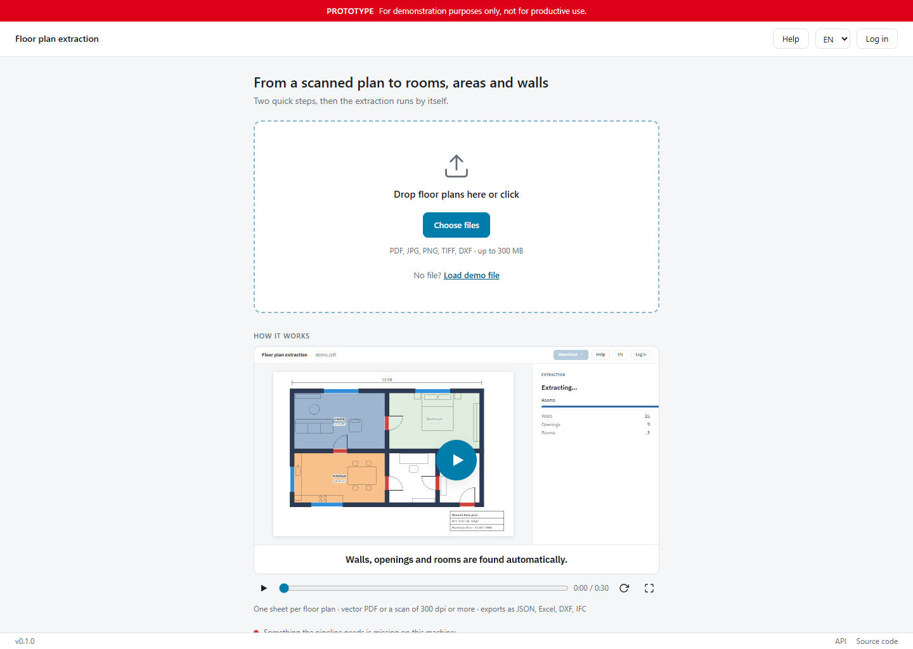
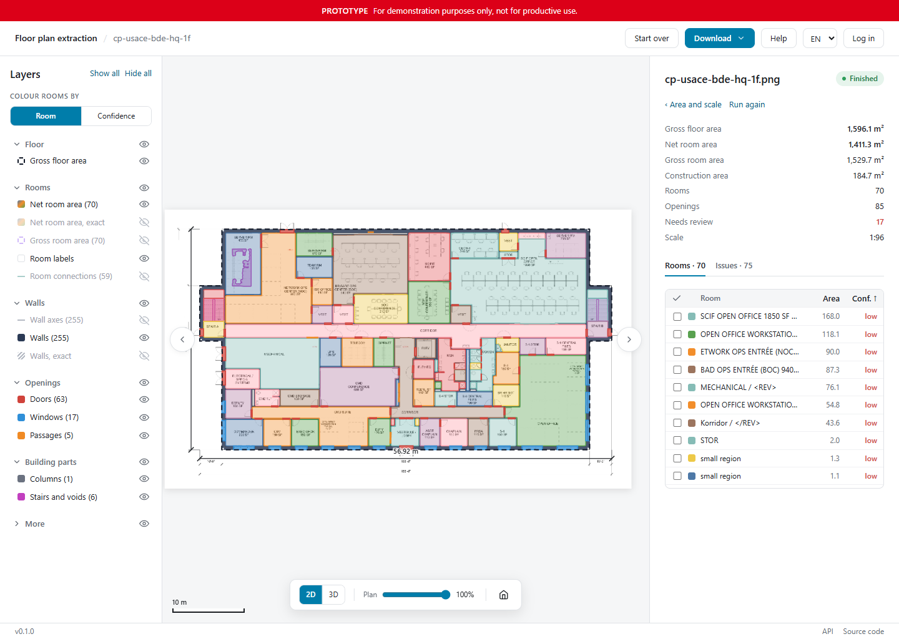

# Floor Plan Extraction

  

> [!CAUTION]  
> Research project. For demonstration purposes only, not for productive use.

Exploring computer-vision extraction of structured floor plan data (rooms, room attributes, walls, openings, stairs, gross floor area) from heterogeneous plan archives for BBL's area management.

This repository brings together research, a target pipeline design and local pilot experiments. The pipeline is under development; the pilots document current findings and limitations.

## Preview

- Live App: https://bbl-dres.github.io/plan-extract/

  
  

## Documentation

- [Motivation and goals](docs/motivation-goals.md) — the area-management problem and project goals.
- [Pipeline design](docs/pipeline.md) — the target workflow, from uploaded plans to structured floor data and review.
- [Literature review and state of the art](docs/literature-review.md) — methods, evidence and remaining challenges.
- [Research sources](docs/papers/sources.md) — the shared bibliography for the documentation and pilots.

## Experiments

| Pilot | Focus |
|---|---|
| [Landgut Lohn · v1](pilot/landgut-lohn-og1/README.md) | Classical computer vision and a vision-language model on a first-floor plan |
| [Graph pipeline · v2](pilot/v2-pipeline/README.md) | A graph-based pipeline with a segmenter trained on style-randomised Swiss Dwellings renders |

Each pilot includes its own scripts, findings and instructions. Plan data and derived overlays stay local.

## Repository layout

| Folder | Content |
|---|---|
| [`docs/`](docs/) | [Motivation and goals](docs/motivation-goals.md), [pipeline design](docs/pipeline.md), [literature review and state of the art](docs/literature-review.md); solutions: [open](docs/solutions-open.md) and [closed](docs/solutions-closed.md); datasets: [open](docs/datasets-open.md), [open building documentation](docs/datasets-open-docu.md) and [closed](docs/datasets-closed.md); [research reports](docs/reports/README.md); [research notes](docs/research/) (e.g. [reading DWG files](docs/research/2026-10-15-dwg-reading.md)) |
| [`docs/papers/`](docs/papers/README.md) | The shared [source list](docs/papers/sources.md), an index of papers and practitioner sources ([papers.json](docs/papers/papers.json)), and scripts to download papers and convert them to Markdown |
| [`pilot/`](pilot/) | Experiments on real plans: [v1](pilot/landgut-lohn-og1/README.md) (classical CV and a VLM on Landgut Lohn, 1. OG) and [v2](pilot/v2-pipeline/README.md) (the graph pipeline with a segmenter trained on style-randomised Swiss Dwellings renders); scripts, findings and overlay viewers |
| [`data/`](data/README.md) | Training and evaluation data (local only) |
| [`assets/`](assets/) | README artwork and social preview |

## Data

Non-public training data everything derived from them (`pilot/**/data/`, `data/`), downloaded papers, their Markdown conversions and saved web pages stay local and are gitignored.

## Licence

The code and documentation of this repository are under the [MIT licence](LICENSE). Third-party material keeps its own licence: the curated plans and their images ([data/curated/plans.json](data/curated/plans.json)), the demo sheet ([app/demo/README.md](app/demo/README.md)), the vendored three.js ([app/js/vendor/three/LICENSE](app/js/vendor/three/LICENSE)), and the datasets and models named in [data/README.md](data/README.md) and the pilot READMEs. The workflow app uses PyMuPDF (AGPL-3.0); the public instance at [plan-extract.ch](https://plan-extract.ch) runs the code of this repository.
